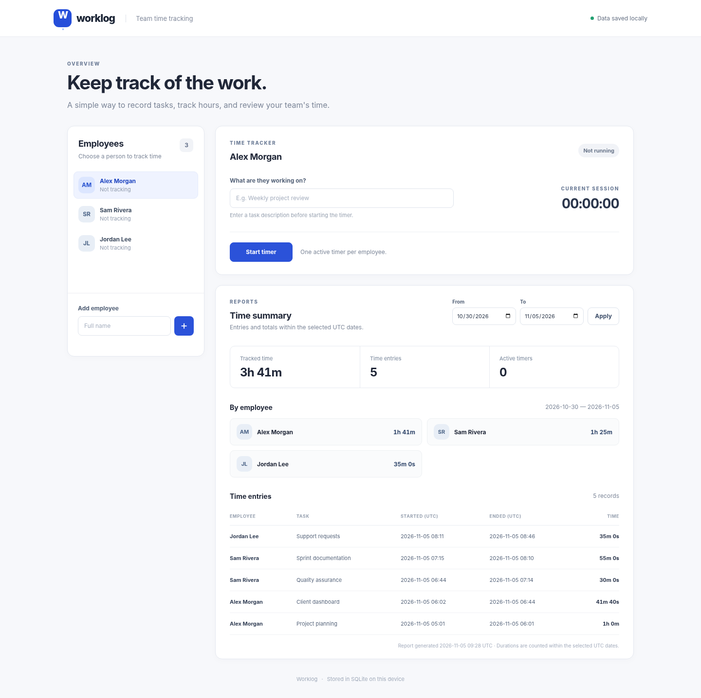

# Worklog

A small local web app for tracking employee work hours. Add an employee, describe a task, and start a timer. Stop it when the work is done, then review each employee's entries and total time for a selected date range.



**Stack:** Python 3.10+ (standard library), SQLite, HTML, CSS, and JavaScript. No packages to install or account required.

## Run locally

```bash
python3 app.py
```

Open **http://127.0.0.1:8000** in your browser.

The database is created automatically at `data/tracker.sqlite3`. Employees, time entries, and running timers persist across server restarts. To use a different database or port:

```bash
python3 app.py --port 8080 --db ./worklog.sqlite3
```

You can also set `TIME_TRACKER_DB` to change the default database path.

### Try it

1. Add an employee (for example, Alex Morgan).
2. Select the employee, type a task, and start the timer.
3. Stop the timer, or leave it running and restart the server. A running timer keeps its original start time, including time while the server was stopped.
4. Adjust the **From** and **To** dates and click **Apply** to review entries and totals.
5. Start another session for the same employee to record a second task.

To load sample data, run this once **before** creating any employees:

```bash
python3 -m scripts.seed_demo
```

It creates three fictional employees with sample tasks. The seed script won't modify a database that already contains employees. All data in the demo and automated tests is fictional.

## Tests

```bash
python3 -m unittest discover -s tests -v
```

The tests cover:

- adding employees, starting and stopping sessions, and starting a new session after stopping one;
- preventing overlapping active timers for one employee, including two concurrent starts;
- rejecting a repeated stop without changing the saved record;
- restoring a running timer from the database after reopening the app;
- empty reports (including employees with zero entries);
- reports with multiple employees and work sessions spanning midnight;
- report consistency when another connection creates an employee and starts a timer between report queries;
- date and input validation;
- HTTP endpoints and persistence across an HTTP server restart.

Frontend regression tests require Node.js 24 and use its built-in test runner:

```bash
node --check static/app.js
node --test tests/test_frontend.js
```

These tests check out-of-order responses, failures from superseded requests, and errors from the latest request. They run the application JavaScript with a minimal DOM test double rather than a browser.

No packages or additional test frameworks are required. Node.js is needed only for frontend tests. Run all commands from the project directory. If your system uses `python` for Python 3, use it instead of `python3`.

The GitHub Actions workflow in `.github/workflows/tests.yml` runs on every push and pull request. It tests Python 3.10 and 3.14 and runs the JavaScript checks on Node.js 24. The first GitHub Actions run completed successfully.

## How it works

The Python server serves a small JSON API and three static files. SQLite stores employees and time entries in two tables. Each time entry has a start timestamp and an optional end timestamp; a missing end timestamp means the timer is still running.

A partial unique index enforces one running session per employee. Timer writes use an immediate SQLite transaction to handle competing requests. The browser updates the clock every second; recorded durations are calculated from timestamps stored in SQLite.

Reports read employees and entries in a single explicit SQLite read transaction. The frontend applies only the latest report request's result and ignores responses and errors from superseded requests.

| Method | Endpoint | Purpose |
| --- | --- | --- |
| `GET` | `/api/employees` | Employees and current active sessions |
| `POST` | `/api/employees` | Add an employee (`name`) |
| `POST` | `/api/timer/start` | Start (`employee_id`, `description`) |
| `POST` | `/api/timer/stop` | Stop (`employee_id`) |
| `GET` | `/api/report?from=YYYY-MM-DD&to=YYYY-MM-DD` | Records and totals within the date range |

Reports use **UTC** dates and include both selected dates. If a session crosses a period boundary, only time within the selected period is counted. Running sessions are counted up to the time the report is generated. Click **Apply** to refresh the report.

The application is designed for local use. It has no authentication or role-based access control and binds to `127.0.0.1` by default. It should not be exposed directly to the public internet.

## AI-assisted development

I used **ChatGPT** for the initial implementation and **OpenAI Codex** for code review, bug fixes, regression tests, and CI setup. The exact model versions could not be verified from the available session history.

I defined the requirements and kept the final revision focused on the assignment: preserve the existing stack and interface, fix confirmed defects, and verify the main user workflows without adding features.

The review focused on data integrity and predictable behavior: one active timer per employee, persistence across restarts, and correct totals for the selected period. These rules are enforced in the database and backend, with tests covering concurrent requests and empty reports. Both report defects were reproduced with failing tests before the fixes were applied. Automated tests and a browser smoke check then verified the changes.

Examples of actual requests from the development conversation (excerpts in the original Russian):

> Добавь регрессионные тесты для обеих ошибок.

> Не меняй стек, дизайн и существующую архитектуру без необходимости. Не добавляй новые функции.

> Запусти все тесты и проверь, что приложение работает после изменений.

### Issues found and corrected

- **Inconsistent report reads.** Employees and entries were read in separate SQLite snapshots. Creating an employee and starting a timer between the queries caused a `KeyError`. An explicit read transaction now gives both queries a consistent snapshot. The regression test commits writes through a second connection between the queries and checks that the current report remains consistent while the next report includes the new data.
- **Out-of-order report responses.** A late response could replace the report for a more recently selected date range, and an older request's error could appear after a newer request succeeded. A request counter now ensures that only the latest request can update the report or report an error. Regression tests cover reversed response order, superseded failures, and failures from the latest request.
